# Showing a machine in the visualisation: guide to the PLC library `Syn_Visu`

This guide is for PLC programmers who connect a machine to the web visualisation. It explains, task by task, how
to use the TwinCAT library `Syn_Visu` (installed as `SynVisu`) so that conveyors, products, robots, XTS tracks and
detectors appear in the 3D view and move with the machine.

Every object, method and enumeration of the library is listed in the [reference](#19-reference) at the end. The
demo project `plc/Syn_Visu_Demo` (solution `plc/RPP_Visu.sln`) is a complete working example; this guide quotes it
where it helps.

The gateway serves this guide at `/docs` (the link in the web app's status bar), always for the library version
the gateway expects.

Contents:

1. [How it works](#1-how-it-works)
2. [Setting up the project](#2-setting-up-the-project)
3. [The pattern every component follows](#3-the-pattern-every-component-follows)
4. [Coordinates](#4-coordinates)
5. [Conveyors and products](#5-conveyors-and-products)
6. [Zones](#6-zones)
7. [Grippers and fingers](#7-grippers-and-fingers)
8. [Delta robot](#8-delta-robot)
9. [Cartesian robot](#9-cartesian-robot)
10. [XTS tracks and their motor modules](#10-xts-tracks-and-their-motor-modules)
11. [XTS gantry](#11-xts-gantry)
12. [XTS loop](#12-xts-loop)
13. [Vision system, product sensor and station](#13-vision-system-product-sensor-and-station)
14. [Faults](#14-faults)
15. [Wrapping existing machine code](#15-wrapping-existing-machine-code)
16. [Limits](#16-limits)
17. [Checklist before commissioning](#17-checklist-before-commissioning)
18. [Troubleshooting](#18-troubleshooting)
19. [Reference](#19-reference)

---

## 1. How it works

The visualisation configures itself from what the PLC reports. Nothing about the machine is entered in the web app.


- **Manifest:** One structure, `GVL_Visu.stManifest`, lists every component. Each entry holds an id, a name, a type
  and the symbol path of the component's data.
- **Config:** What does not change while the machine runs: pose, size, product types, zones, track modules. The
  gateway reads it once, and again whenever `nConfigVersion` in the manifest changes.
- **State:** What changes every cycle: belt position, products, TCP, mover positions, faults. The gateway reads all
  states every cycle in one sum read.

You never write these structures yourself. Every component has a function block in the library; you call its
methods, and it fills its output `vo_Visu`, the structure the gateway reads.

## 2. Setting up the project

### 2.1 Install and reference the library

1. Install the released library: `plc\Syn_Visu_<version>.compiled-library` from the deployment package (compiled,
   without source code), or `plc/library/Syn_Visu_<version>.library` from this repository (with source). In XAE:
   PLC → Library Repository → Install. It is installed as **`SynVisu`** from **Syntegon Group**.
2. In your PLC project add a reference: References → Add Library → `SynVisu`. A placeholder reference (newest
   version) is fine.
3. The library's namespace is `SynVisu`. Qualify its objects: `SynVisu._FB_VisuConveyor`, `SynVisu.ST_VisuPose`,
   `SynVisu.E_VisuModuleKind.STRAIGHT`.

### 2.2 Match the gateway

The PLC and the gateway must speak a protocol version they share. The gateway reads its own protocol version and the
one before (22 and 21); it refuses a PLC with any other and says so in its status.

| Library `SynVisu` | Protocol version | Gateway |
| --- | --- | --- |
| 9.7.x | 22 | releases from protocol 22 on; `_FB_VisuMachine` reports the machine's run state, simulation mode and machine messages in `GVL_Visu.stMachine` (section 14.1); no change to existing calls, and an application without `stMachine` works as before |
| 9.6.x | 21 | releases from protocol 21 on; `m_SetProductMark` and `_FC_VisuSetMarkName` mark products to single them out (section 5.5); no change to existing calls. With `SynConfig`, use 2.0.1 or newer: it takes `SynVisu` through a placeholder, so both use the same version |
| 9.5.x | 20 | releases from protocol 20 on; `m_SetFingerOffset` places a finger on the gripper flange, drawn there while its pose is not reported (section 7); no change to existing calls |
| 9.4.x | 19 | releases from protocol 19 on; `m_SetTcpLimitArea` for a box around the TCP (section 8); no change to existing calls |
| 9.3.x | 18 | releases from protocol 18 on; `m_SetLimitArea` also for the XTS gantry and the Cartesian robot (section 9); no change to existing calls |
| 9.2.x | 17 | releases from protocol 17 on; `m_SetKinematics` for a Cartesian robot without a Y or a Z axis (section 9); no change to existing calls |
| 9.1.x | 16 | releases from protocol 16 on; `m_SetBodyVisible` for a conveyor without a body (section 5.1); no change to existing calls |
| 9.0.x | 15 | releases from protocol 15 on; `m_SetZone` has `vi_lr_StartY`, `vi_lr_EndY` (add `vi_lr_StartY := 0, vi_lr_EndY := 0` to every call for the whole belt width, section 6) |
| 8.0.x | 14 | releases from protocol 14 on; `m_Register` without `vi_str_Path` (remove it from every call, section 3.2); methods without default values, every call lists all inputs (section 3.3) |
| 7.0.x | 14 | releases from protocol 14 on (product poses in the conveyor's coordinate system) |
| 6.0.x | 13 | releases from protocol 13 on (generic product client, station) |
| 5.1.x | 12 | protocol 12; the status bar also shows the library version |
| 5.0.x | 12 | protocol 12 (XTS tracks of motor modules) |
| 4.0.x | 11 | protocol 11 (vision system, product sensor) |

The protocol version is `SynVisu.VISU_GlobalConst.VISU_un_PROTOCOL_VERSION`; the manifest is initialised with it.
The library version is available at runtime from `SynVisu._FC_GetVersionSynVisu(1 | 2 | 3)`.

### 2.3 Declare the manifest

The manifest belongs to your application, not to the library. Create a GVL named **`GVL_Visu`** with one variable
named **`stManifest`**. The gateway reads exactly this symbol path:

```st
{attribute 'qualified_only'}
VAR_GLOBAL
	stManifest							: SynVisu.ST_VisuManifest;	// read by the visualisation gateway
END_VAR
```

If your project must use a different name, set the gateway option `manifestPath` to the symbol path instead.

To report the machine's run state and machine messages (section 14.1), declare the machine entry **`stMachine`** in
the same GVL. It is optional: without it the visualisation simply shows no run state.

```st
{attribute 'qualified_only'}
VAR_GLOBAL
	stManifest							: SynVisu.ST_VisuManifest;	// read by the visualisation gateway
	stMachine							: SynVisu.ST_VisuMachine;	// run state and machine messages (protocol 22)
END_VAR
```

### 2.4 Where to call it

Call the visualisation code once per cycle, in the task that has the actual values. This is usually the fast task
that also runs the motion, so that TCPs and mover positions are consistent with each other. All component FBs stamp
their state with the distributed-clock time of the cycle that wrote it; the web app interpolates between cycles. The
cost is small: a few method calls per component, no ADS traffic from the PLC side.

## 3. The pattern every component follows

Every component is one FB instance. Each cycle you call, in this order:

1. **Register:** `m_Register(...)` adds the component to the manifest.
2. **Configure:** `m_Configure(...)` and the other configuration methods (`m_SetZone`, `m_SetFinger`,
   `m_SetModule`, ...).
3. **Report:** the state methods (`m_SetBeltPosition`, `m_SetTcp`, `m_SetMover`, ...).


All three may be called every cycle. Registration is idempotent and keeps the manifest valid after an online change.
The configuration methods bump the config version only when a value actually changes; they return TRUE in that case.
So you do not need first-cycle flags.

```st
PROGRAM MAIN
VAR
	fb_Infeed							: SynVisu._FB_VisuConveyor;
	InfeedPose							: SynVisu.ST_VisuPose := (fX := 0, fY := 0, fZ := 800);
END_VAR

(* 1. Register: id and display name; the symbol path comes from the instance itself *)
fb_Infeed.m_Register(vio_Manifest := GVL_Visu.stManifest, vi_udn_Id := 1, vi_str_Name := 'Infeed');

(* 2. Configure *)
fb_Infeed.m_Configure(vi_Pose := InfeedPose, vi_lr_Length := 3000, vi_lr_Width := 400);
fb_Infeed.m_SetProductType(vi_udn_Id := 1, vi_lr_Length := 120, vi_lr_Width := 80, vi_lr_Height := 40,
	vi_e_Shape := SynVisu.E_VisuProductShape.BOX, vi_lr_CornerRadius := 0);

(* 3. Report *)
fb_Infeed.m_SetBeltPosition(lr_InfeedBeltPosition);
```

### 3.1 Ids

- Every component needs an id (`vi_udn_Id`) that is unique within the PLC and greater than 0.
- Components refer to each other by these ids: a zone names its conveyor, a product names the client that changed
  it last (robot, detector, station). Use `fb_Other.m_Id()` instead of repeating the number.
- Plan the ids once per machine, e.g. conveyors 1–19, Deltas 10–29, XTS 30–39, detectors 50–59, stations 60–69, and keep them in
  constants. Ids are shown in the component tree and stored in recordings, so do not change them between
  versions of a machine without reason.

### 3.2 The symbol path

The manifest tells the gateway where each component's output `vo_Visu` lies, as a symbol path exactly as ADS sees
it. Since library 8.0 every component finds it itself: TwinCAT gives each instance its path in the device tree
(attribute `instance-path`), `m_Register` leaves out the leading segments that are not part of the symbol path and
appends `.vo_Visu`:

| Where the instance is declared | Symbol path in the manifest |
| --- | --- |
| `PROGRAM MAIN`, variable `fb_Infeed` | `MAIN.fb_Infeed.vo_Visu` |
| A program `P_Line1`, variable `fb_Delta1` | `P_Line1.fb_Delta1.vo_Visu` |
| Inside an FB instance `MAIN.fb_Cell.fb_Robot` | `MAIN.fb_Cell.fb_Robot.vo_Visu` |
| In a GVL `GVL_Machine`, variable `fb_Outfeed` | `GVL_Machine.fb_Outfeed.vo_Visu` |

The device tree path starts with the TwinCAT project and the PLC project, e.g.
`RPP_Visu.Syn_Visu_Demo.P_VisuDemoDelta.fb_Infeed1` in the demo; the library parameter
`VISU_un_INSTANCE_PATH_SKIP` (default 2) says how many leading segments are left out. A project whose path has more
segments before the program or GVL sets it in the library parameters of its `SynVisu` reference. If the gateway
reports a discovery error for every component, the instance paths show what to set it to: `str_InstancePath` and the
resulting `str_SymbolPath` of any component instance in the online view (see [Troubleshooting](#18-troubleshooting)).
A component works its path out once; after changing the parameter, reset the PLC (cold) or download it.

### 3.3 Every input in every call

Call every method with all its inputs. Since library 8.0 the methods have no default values: an input left out
works only from TwinCAT 3.1 Build 4026, and machine projects still run on 4024. The compiler names a call that
misses one ("Function 'm_SetZone' requires exactly '8' inputs"). Each input's comment says which value means
"none", e.g. `vi_lr_AllocationOffset := 0` (no limit), `vi_udn_MoverId := 0`, `vi_str_FaultMessage := ''`; a
standard XTS module is `vi_lr_Length := SynVisu.VISU_GlobalConst.VISU_lr_XTS_MODULE_LENGTH`.

## 4. Coordinates

- **MCS (machine coordinate system):** millimetres and degrees, right-handed, Z up, X in the product flow
  direction. Every pose you pass to `m_Configure` is in the MCS.
- **Poses:** `ST_VisuPose` (`fX`, `fY`, `fZ`, `fRx`, `fRy`, `fRz`). Rotation order R = Rz · Ry · Rx. Most components
  only need `fRz` (turned about the vertical).
- **Local frames:** each component type defines where its pose lies and how its axes run; see its section below.
  A component turned by `fRz := 90` has its local +X along MCS +Y.
- **Belt coordinates:** positions along a conveyor (zones, CCS) are measured along the belt from its start, or from
  its origin shift (below), not in the MCS.
- **Product poses** (latch pose, `m_GetProduct`, `m_MoveProduct`) are in the conveyor's coordinate system: from its
  pose moved by its origin shift, X along the belt, Y across it, Z up from the belt surface, Rz from the belt's X.
- **Absolute values:** finger poses and the Delta's TCP are absolute in the MCS.
- **Origin shift:** `m_SetOriginShift(vi_lr_X, vi_lr_Y, vi_lr_Z)` moves the component's shown coordinate system away
  from its pose (mm in the component's local frame). The origin triad (layer "Coordinate systems", always shown while
  measuring) and the local measuring coordinates in the web app use it. For a **conveyor** the belt coordinates also
  count from the shifted X; use this when the machine's queue coordinates do not start at the belt start. For robots it only moves the shown origin.


Tip: the measuring mode in the web app (key M) shows MCS and local coordinates of characteristic points. Use it to
check poses on the real machine.

## 5. Conveyors and products

FB: `SynVisu._FB_VisuConveyor`. A conveyor is a belt of a given length and width, plus a register of the products
on it (up to `VISU_un_MAX_PRODUCTS`, 4800).

### 5.1 Configuration

| Call | Meaning |
| --- | --- |
| `m_Configure(vi_Pose, vi_lr_Length, vi_lr_Width)` | `vi_Pose` is the centre of the belt start on the belt surface; local +X is the conveying direction, local Z the belt normal |
| `m_SetBodyVisible(vi_b_Visible)` | TRUE (default) draws the belt as a body. FALSE for a conveyor without one, e.g. products pushed along by XTS movers: only its products, zones and axis are drawn. Length and width still bound the belt coordinates. |
| `m_SetProductType(vi_udn_Id, vi_lr_Length, vi_lr_Width, vi_lr_Height, vi_e_Shape, vi_lr_CornerRadius)` | One per product type on this belt (up to 8) |

Product shapes (`SynVisu.E_VisuProductShape`):

| Shape | Use for | Size |
| --- | --- | --- |
| `BOX` | cartons, trays | length (along the belt) × width × height |
| `CYLINDER` | cans, round or oval products | length and width are the two diameters: equal for round, different for oval |
| `ROUNDED_BOX` | pouches, flow packs | a box with rounded vertical edges of `vi_lr_CornerRadius` |

### 5.2 Belt position

Report the belt position once per cycle, **before** latching products in that cycle:

- `m_SetBeltPosition(vi_lr_Position)` for a continuous position in mm. It must not jump back or wrap.
- `m_SetModuloBeltPosition(vi_lr_ModuloPosition, vi_lr_ModuloPeriod, vi_b_Reset)` for a modulo axis. The FB unwraps
  it; the axis must move less than half a period per cycle.

Products on the belt move with the belt position: the visualisation computes each product's position from its latch
pose and how far the belt has moved since the latch. You do not report product positions every cycle.

### 5.3 The product lifecycle

Every product has an id that is unique on its conveyor and greater than 0. Its state (`SynVisu.E_VisuProductState`)
drives how it is drawn.

| Moment | Call | Shown as |
| --- | --- | --- |
| Product detected on the belt | `m_LatchProduct(vi_udn_Id, vi_LatchPose, vi_udn_ProductType, ..., vi_e_State := DETECTED, vi_udn_ClientId := fb_Vision.m_Id())` | `DETECTED`, travelling with the belt |
| A robot takes the product over | `m_SetProductState(vi_udn_Id, ASSIGNED, vi_udn_ClientId := fb_Delta.m_Id(), vi_udn_MoverId := 0, vi_udn_FingerId := 0)` | `ASSIGNED`, coloured as allocated |
| The robot gives it up again | `m_SetProductState(vi_udn_Id, DETECTED, vi_udn_ClientId := fb_Delta.m_Id(), vi_udn_MoverId := 0, vi_udn_FingerId := 0)` | `DETECTED`; the history says "released by" the robot |
| The robot picks it | `m_SetProductState(vi_udn_Id, PICKED, vi_udn_ClientId := fb_Delta.m_Id(), vi_udn_MoverId := 0, vi_udn_FingerId := 1)` | Hangs from the robot's finger; a placeholder outline stays on the belt |
| The robot puts it down on another belt | `fb_Infeed.m_RemoveProduct(vi_udn_Id)` and `fb_Outfeed.m_LatchProduct(..., vi_e_State := PLACED, vi_udn_ClientId := fb_Delta.m_Id())` | `PLACED` on the outfeed |
| Put back onto the same belt | `m_SetProductState(vi_udn_Id, PLACED, vi_udn_ClientId := fb_Delta.m_Id(), vi_udn_MoverId := 0, vi_udn_FingerId := 0)` | `PLACED` |
| Rejected (bad product), e.g. by a reject unit | `m_SetProductState(vi_udn_Id, REJECTED, vi_udn_ClientId := fb_RejectUnit.m_Id(), vi_udn_MoverId := 0, vi_udn_FingerId := 0)` | `REJECTED`, passes the belt end on purpose |
| Housekeeping, every cycle | `m_RemoveProductsBeyond(vi_lr_BeltX := Length + 300)` | Drops products beyond the belt end; keeps `ASSIGNED` and `PICKED` |



Rules:

- **Latch pose:** `vi_LatchPose` (`ST_VisuPlanarPose`: X, Y, Z, Rz) is the bottom centre of the product on the belt
  surface, in the conveyor's coordinate system (from its origin shift), at the latch moment. A product detected
  where the belt's coordinate system starts has `fX = 0`, one in the middle of the belt `fY = 0`, `fZ` is 0 on the
  belt surface. A product put down on top of another has `fZ` = the height of the one below; it travels with the belt
  on its own, so when the one below is picked, move the one above down yourself (`m_MoveProduct`, `fZ := 0`). If the product was detected some cycles earlier, pass the belt position
  of that moment in `vi_lr_LatchBeltPosition` with `vi_b_UseLatchBeltPosition := TRUE`.
- **Missed products:** a product that passes the belt end while still `DETECTED` or `ASSIGNED` is flagged as missed
  in the web app (red, counted in the metrics, marked on the recording's timeline). `PLACED` and `REJECTED`
  products pass the end on purpose.
- **Placing:** a robot works in the MCS (finger poses), so convert where its finger puts the product down into the
  outfeed's coordinate system, and set `fRz` to the finger's MCS rotation about Z minus the outfeed's, so the product
  keeps its orientation. For a belt along MCS +X: `fX = x − (pose.fX + shift.fX)`, `fY = y − (pose.fY + shift.fY)`.
- **The client:** every call that latches or changes a product names the client that does it in `vi_udn_ClientId`:
  the vision system, sensor or station that latched it, the robot that is assigned to, picks, places or releases it,
  the station that rejects it. The product keeps it as `nLastClientId`, with the state before the change as
  `ePreviousState`. The inspector's product history then says who did what ("detected by Vision 1", "picked by
  Delta 1", "rejected by Reject unit"), and the metrics count per client.
- **Reading the register:** `m_ProductCount()`, `m_GetProduct(vi_un_Index, vo_Product =>, vo_Pose =>)` (with the
  product's current pose in the conveyor's coordinate system: the latch pose moved along X by the belt travel), `m_FindProduct(vi_udn_Id)`. Useful when the machine's own data does not hold the
  product's position, e.g. to match a pick to the nearest mover.
- **Pushing a product along the belt** (e.g. a spacing XTS loop under the belt): `m_MoveProduct(vi_udn_Id, vi_Pose)`
  puts it at a new pose (conveyor coordinate system) at the current belt position and keeps its state.

### 5.4 Example

```st
(* Configuration *)
fb_Infeed.m_Configure(vi_Pose := InfeedPose, vi_lr_Length := 3000, vi_lr_Width := 400);
fb_Infeed.m_SetProductType(vi_udn_Id := 1, vi_lr_Length := 120, vi_lr_Width := 80, vi_lr_Height := 40,
	vi_e_Shape := SynVisu.E_VisuProductShape.BOX, vi_lr_CornerRadius := 0);
fb_Infeed.m_SetProductType(vi_udn_Id := 2, vi_lr_Length := 80, vi_lr_Width := 80, vi_lr_Height := 40,
	vi_e_Shape := SynVisu.E_VisuProductShape.CYLINDER, vi_lr_CornerRadius := 0);

(* Each cycle: belt first, then latches *)
fb_Infeed.m_SetBeltPosition(axInfeed.NcToPlc.ActPos);
IF b_ProductLatched THEN
	(* In the infeed's coordinate system: along the belt from its origin, across from its middle, on its surface *)
	LatchPose.fX := lr_LatchX;
	LatchPose.fY := lr_LatchY;
	LatchPose.fZ := 0;
	LatchPose.fRz := lr_LatchRz;
	fb_Infeed.m_LatchProduct(vi_udn_Id := udn_ProductId, vi_LatchPose := LatchPose, vi_udn_ProductType := 1,
		vi_lr_LatchBeltPosition := 0, vi_b_UseLatchBeltPosition := FALSE,
		vi_e_State := SynVisu.E_VisuProductState.DETECTED, vi_udn_ClientId := fb_Vision1.m_Id());
END_IF
fb_Infeed.m_RemoveProductsBeyond(3000 + 300);
```

### 5.5 Product marks

Mark single products to single them out, e.g. samples taken for a quality check or a product under tracking. The
visualisation draws a marked product in its mark's colour instead of its state colour (layer "Product marks"), and
its inspector names the mark.

- **Name the marks once for the whole PLC:** `SynVisu._FC_VisuSetMarkName(vio_Manifest := GVL_Visu.stManifest,
  vi_un_Mark := 1, vi_str_Name := 'Sample')`. Up to `VISU_un_MAX_MARKS` (4) marks; a mark means the same on every
  conveyor. Call it every cycle like the configuration methods: it bumps the config version only when the name changes.
- **Mark a product:** `fb_Infeed.m_SetProductMark(vi_udn_Id := udn_ProductId, vi_un_Mark := 1)`, `vi_un_Mark := 0`
  removes the mark. FALSE for a product not in the register or a mark above 4.
- **The mark stays** through `m_SetProductState` and `m_MoveProduct`. `m_LatchProduct` starts a product unmarked: a
  product a robot puts down on another conveyor is a new register entry there, so mark it again after latching it
  (read its mark before with `m_GetProduct`).

```st
(* Every tenth product the vision system latches is a sample. *)
SynVisu._FC_VisuSetMarkName(vio_Manifest := GVL_Visu.stManifest, vi_un_Mark := 1, vi_str_Name := 'Sample');
IF fb_Infeed.m_LatchProduct(...) THEN
	un_Latched := un_Latched + 1;
	IF un_Latched MOD 10 = 0 THEN
		fb_Infeed.m_SetProductMark(vi_udn_Id := udn_ProductId, vi_un_Mark := 1);
	END_IF
END_IF
```

## 6. Zones

A zone is a stretch of a conveyor that belongs to a component: where a robot picks or places, where a detector
detects, where a station works. All robots, detectors and stations have zones; the visualisation draws them alike.
A zone spans the whole belt width, or only a lane of it when its sides across the belt are given, e.g. a robot
that picks only from the left half of the belt.



```st
fb_Delta1.m_SetZone(vi_un_Zone := 1, vi_udn_ConveyorId := fb_Infeed.m_Id(),
	vi_lr_Start := 1100, vi_lr_End := 1900, vi_lr_AllocationOffset := 300, vi_lr_CcsOffset := 1100,
	vi_lr_StartY := 0, vi_lr_EndY := 0);
(* Places only on the left half of the outfeed (400 mm wide, its origin on the centre line). *)
fb_Delta1.m_SetZone(vi_un_Zone := 2, vi_udn_ConveyorId := fb_Outfeed.m_Id(),
	vi_lr_Start := 1200, vi_lr_End := 1800, vi_lr_AllocationOffset := 0, vi_lr_CcsOffset := 1200,
	vi_lr_StartY := 0, vi_lr_EndY := 200);
```

| Input | Meaning |
| --- | --- |
| `vi_un_Zone` | 1-based. Set the zones in order 1, 2, 3, ...; the count grows to the highest one set. Up to 8. |
| `vi_udn_ConveyorId` | The conveyor's id (`fb_Belt.m_Id()`) |
| `vi_lr_Start`, `vi_lr_End` | Belt coordinates in mm (from the belt start or its origin shift). `Start = End` draws a line across the belt, e.g. for a light barrier. |
| `vi_lr_AllocationOffset` | mm before `End` up to which the robot may still allocate products; drawn as its own area. 0 = no limit. |
| `vi_lr_CcsOffset` | Belt coordinate of the component's conveyor coordinate system (CCS), drawn as a white dashed line across the zone. It may lie outside the zone, but must lie on the belt (between its start and end), else a warning. |
| `vi_lr_StartY`, `vi_lr_EndY` | The zone's sides across the belt in mm, along the conveyor's local Y from its origin shift (like a product's latch pose; 0 = the belt's centre line without a shift), in any order. Equal (e.g. both 0) = the whole belt width. A zone may reach past the belt's sides; it is drawn as reported. |

`vi_lr_Start` and `vi_lr_End` should lie on the belt; a zone reaching past the belt start or end is drawn as
reported, with a warning.

`m_ClearZones()` removes all zones, e.g. when a format change uses fewer zones.

## 7. Grippers and fingers

Every robot type (Delta, Cartesian, XTS gantry, XTS loop) may define a gripper made of **fingers**. A finger is
always drawn as a cylinder: a suction cup, a jaw, a pin. Picked products hang from a finger.

- **Define** the fingers once (every cycle is fine): `m_SetFinger(vi_un_Finger, vi_lr_Diameter, vi_lr_Height)`,
  1-based, up to 8. For XTS kinematics this defines the fingers of every mover's gripper.
- **Place** each finger on the gripper flange: `m_SetFingerOffset(vi_un_Finger, vi_lr_X, vi_lr_Y, vi_lr_Z, vi_lr_Rz)`,
  its position in the flange frame and its rotation about the flange's Z (ADR 0018). The flange frame's −Z points to
  the product: a Delta's lies at the TCP with the robot's axes, a Cartesian robot's has the robot's axes, an XTS
  mover's turns with the mover. The configurator lays the fingers out in a top view of the flange.
- **Report** each finger every cycle, **absolute in the MCS**: the pose of the finger's frame and whether it grips.
  - Delta and Cartesian: `m_SetFingerState(vi_un_Finger, vi_Pose, vi_b_Active)`.
  - XTS gantry and loop: in the `vi_FingerStates` array of `m_SetMover` (index 0 = finger 1).
- **Or let the visualisation place them:** a finger whose pose the application does not report is drawn at its
  offset on the flange, so the gripper geometry is programmed only once. A Delta or Cartesian robot's finger counts
  as reported once `m_SetFingerState` was called for it; an XTS track reports none after
  `m_SetFingersOnFlange(vi_b_OnFlange := TRUE)`, and `vi_FingerStates` then only says whether each finger grips. A
  tool rotation does not show on fingers placed this way.
- **Finger frame:** origin at the centre of the finger's top face (where it is mounted). The finger extends along its
  local −Z; its grip point is the centre of its bottom face. A picked product's top touches the grip point and takes
  the finger's orientation.
- **Rotations:** a tool rotation (a Delta's 4th axis, an IDH's C, a Cartesian's C and A) is shown only through the
  finger poses. Turn the finger frame by that rotation.
- **Which finger carries a product:** `m_SetProductState(..., PICKED, vi_udn_ClientId, vi_udn_MoverId, vi_udn_FingerId)`.
  With `vi_udn_FingerId := 0` the product hangs at the gripper flange instead.
- **Without fingers:** the flange is drawn as a plate, green while `vi_b_GripperActive` (Cartesian, XTS gantry) is
  TRUE.



```st
(* A suction cup 50 mm high directly below a Delta's TCP, turned by the 4th axis *)
fb_Delta1.m_SetFinger(vi_un_Finger := 1, vi_lr_Diameter := 40, vi_lr_Height := 50);
CupPose.fX := Tcp.fX;
CupPose.fY := Tcp.fY;
CupPose.fZ := Tcp.fZ;
CupPose.fRz := lr_Axis4;
fb_Delta1.m_SetFingerState(vi_un_Finger := 1, vi_Pose := CupPose, vi_b_Active := b_Vacuum);

(* An XTS loop whose cups the visualisation places: 0 mm from every mover's flange, no poses reported *)
fb_Fxx.m_SetFinger(vi_un_Finger := 1, vi_lr_Diameter := 40, vi_lr_Height := 50);
fb_Fxx.m_SetFingerOffset(vi_un_Finger := 1, vi_lr_X := 0, vi_lr_Y := 0, vi_lr_Z := 0, vi_lr_Rz := 0);
fb_Fxx.m_SetFingersOnFlange(vi_b_OnFlange := TRUE);
```

## 8. Delta robot

FB: `SynVisu._FB_VisuDelta`. The PLC reports only the TCP; the web app computes the arm posture from the geometry.


| Call | Meaning |
| --- | --- |
| `m_Configure(vi_Pose, vi_lr_BaseRadius, vi_lr_EffectorRadius, vi_lr_UpperArmLength, vi_lr_LowerArmLength)` | `vi_Pose` is the base centre in the MCS. Arm 1 lies along the base's local +X, arms 2 and 3 follow counter-clockwise (from above) at 120°. |
| `m_SetWorkingArea(vi_lr_Radius, vi_lr_ZMin, vi_lr_ZMax, vi_lr_ConeHeight, vi_lr_ConeBottomRadius)` | Vertical cylinder in the robot frame (Z negative below the base), optionally with a cone at the bottom |
| `m_SetLimitArea(vi_lr_XMin, vi_lr_XMax, vi_lr_YMin, vi_lr_YMax, vi_lr_ZMin, vi_lr_ZMax)`, `m_ClearLimitArea()` | Optional box in the robot frame that further restricts the working area, e.g. against a neighbouring robot; equal bounds make a flat box. The XTS gantry and the Cartesian robot have it too. |
| `m_SetTcpLimitArea(vi_lr_XMin, vi_lr_XMax, vi_lr_YMin, vi_lr_YMax, vi_lr_ZMin, vi_lr_ZMax)`, `m_ClearTcpLimitArea()` | Optional box around the TCP, bounds relative to the TCP along the robot frame's axes (see below). The XTS gantry (around every mover's gripper flange) and the Cartesian robot (around its flange) have it too. |
| `m_SetFinger(...)`, `m_SetFingerOffset(...)` | See [section 7](#7-grippers-and-fingers) |
| `m_SetZone(...)` | See [section 6](#6-zones) |
| each cycle: `m_SetTcp(vi_ActualTcp, vi_SetpointTcp)` | TCP (effector centre, the gripper flange) as `ST_VisuPosition` in the MCS |
| each cycle: `m_SetFingerState(...)` | Per finger |

### 8.1 TCP limit area

The TCP limit area is a box around the TCP: what the gripper and the product it carries take up. Its bounds are
relative to the TCP along the axes of the robot frame; it moves with the TCP and never turns. The PLC reports only
the box; the visualisation checks it every frame and lights it up red, with a message in the component list, the
inspector and above the box, while it

- overlaps another robot's limit area or another TCP limit area (also another mover's of the same XTS gantry), or
- leaves its own robot's limit area (a robot without a limit area is not checked for this).

The other box involved lights up too. Boxes that only touch are fine. It is a warning on the screen, not a safety
function: the PLC learns nothing of it. Every start of a violation is marked on the timeline of a recording.



```st
(* Cup and product below the TCP: 160 mm wide, from 100 mm below the TCP to 20 mm above it *)
fb_Delta1.m_SetTcpLimitArea(vi_lr_XMin := -80, vi_lr_XMax := 80, vi_lr_YMin := -80, vi_lr_YMax := 80,
	vi_lr_ZMin := -100, vi_lr_ZMax := 20);
```

## 9. Cartesian robot

FB: `SynVisu._FB_VisuCartesian`. Two fixed rails along the local +Y, a bridge travelling in Y, a carriage on it
travelling in X and a vertical column (Z) ending at the gripper flange; without a Y or a Z axis see the end of this
section.


| Call | Meaning |
| --- | --- |
| `m_Configure(vi_Pose, vi_lr_XMin, vi_lr_XMax, vi_lr_YMin, vi_lr_YMax, vi_lr_ZMin, vi_lr_ZMax, vi_lr_RailHeight)` | `vi_Pose` is the axis origin (X = Y = 0); the strokes are the flange's; the rails' top lies at `vi_lr_RailHeight` above the origin |
| once: `m_SetKinematics(vi_e_Axes)` | Which axes the robot has; leave it out for X, Y, Z (see below) |
| `m_SetLimitArea(...)`, `m_ClearLimitArea()` | Optional box in the robot frame (the frame of the strokes, so in flange coordinates) that further restricts the working area |
| `m_SetTcpLimitArea(...)`, `m_ClearTcpLimitArea()` | Optional box around the flange, relative to it ([section 8.1](#81-tcp-limit-area)) |
| each cycle: `m_SetAxes(vi_lr_X, vi_lr_Y, vi_lr_Z, vi_b_GripperActive)` | Actual axis values, i.e. the flange in the robot frame |
| each cycle: `m_SetFingerState(...)` | Per finger, absolute in the MCS |

If the machine's TCP is not the flange (a tool length), report the flange and let the finger reach down to the TCP:
the finger height is the tool length.

A Cartesian robot with only two axes is the same FB with `m_SetKinematics` (`SynVisu.E_VisuCartesianAxes`):

| `vi_e_Axes` | Robot | Drawn as | Ignored |
| --- | --- | --- | --- |
| `XYZ` (default) | X, Y and Z axis | rails, bridge, carriage, column | nothing |
| `XZ` | no Y axis | a fixed beam along local X at `vi_lr_RailHeight` (no supports), carriage, column; Y is 0 | `vi_lr_YMin`, `vi_lr_YMax`, `m_SetAxes` `vi_lr_Y` |
| `XY` | no Z axis | rails, bridge, carriage and a column of fixed length; the flange stays at `vi_lr_ZMin` | `vi_lr_ZMax`, `m_SetAxes` `vi_lr_Z` |

Turn the robot with the yaw of `vi_Pose` so its X axis runs where the machine's does (along or across the belt).

```st
fb_Pusher.m_Configure(vi_Pose := PusherPose, vi_lr_XMin := 0, vi_lr_XMax := 800, vi_lr_YMin := 0, vi_lr_YMax := 0,
	vi_lr_ZMin := -400, vi_lr_ZMax := 0, vi_lr_RailHeight := 600);
fb_Pusher.m_SetKinematics(vi_e_Axes := SynVisu.E_VisuCartesianAxes.XZ);
fb_Pusher.m_SetAxes(vi_lr_X := ax_X.NcToPlc.ActPos, vi_lr_Y := 0, vi_lr_Z := ax_Z.NcToPlc.ActPos, vi_b_GripperActive := b_Vacuum);
```

## 10. XTS tracks and their motor modules

Both XTS components, the gantry (e.g. IDH) and the loop (e.g. Fxx), describe their track the same way: as a chain of
**track modules** in the order the movers run along it. This mirrors the real hardware: a Beckhoff XTS track is
built from motor modules that are 250 mm long, straight or a 90° curve.

### 10.1 Module kinds

`SynVisu.E_VisuModuleKind`:

| Kind | Hardware | Drawn as |
| --- | --- | --- |
| `STRAIGHT` | straight motor module | a straight block |
| `CURVE_LEFT` | curve module, turning 90° to the left of the direction the track runs in | a quarter ring |
| `CURVE_RIGHT` | curve module, turning 90° to the right | a quarter ring |

Each module has a length along the track (track positions). The default is
`SynVisu.VISU_GlobalConst.VISU_lr_XTS_MODULE_LENGTH` = 250 mm. A curve module is drawn as a quarter circle as long as
the module (radius 2 · 250 / π ≈ 159.2 mm), so a mover's position on it is exact along the track. Two curve modules
in a row make the half turn at the end of a loop.

### 10.2 Setting the modules

```st
(* A straight track of six modules *)
FOR un_Module := 1 TO 6 DO
	fb_Idh.m_SetModule(vi_un_Module := un_Module, vi_e_Kind := SynVisu.E_VisuModuleKind.STRAIGHT,
		vi_lr_Length := SynVisu.VISU_GlobalConst.VISU_lr_XTS_MODULE_LENGTH);
END_FOR
```

- Modules are 1-based and must be set **in track order**, without gaps. Module 1 starts at the component's pose;
  each module starts where the one before it ends.
- **Track positions** count from the start of module 1. Report mover positions in this system.
- The count grows to the highest module set (up to `VISU_un_MAX_MODULES`, 64). If a format change shortens the
  track, call `m_ClearModules()` first.
- `m_TrackLength()` returns the sum of the module lengths: the range of track positions, on a loop its perimeter.
- Calling `m_SetModule` every cycle is fine; the config only changes when a module does.

### 10.3 Module faults

Each module can report its own fault, e.g. an overtemperature or a drive error of that motor module. The faulted
module is drawn red, its message hangs above it, it is listed with the component ("Module 11: Overtemperature") and
marked on the recording's timeline.

```st
fb_Fxx.m_SetModuleFault(vi_un_Module := 11, vi_b_Fault := b_Module11Overtemp,
	vi_str_FaultMessage := 'Overtemperature');
```

Unlike `m_SetFault` (section 14), module faults are live: call `m_SetModuleFault` every cycle with the module's
current state, for every module whose fault you know. A module you never report stays without fault.

## 11. XTS gantry

FB: `SynVisu._FB_VisuXtsGantry`. A straight XTS track carried by a common Z axis; every mover carries its own X axis
with a gripper flange at its end (e.g. IDH).

**Local frame:** origin at the track start on top of the movers with Z = 0; the track runs along local +Y, each
mover's X axis along local +X, the Z axis along local +Z. Turn the pose (`fRz`) so that the track lies where it does
in the machine.



| Call | Meaning |
| --- | --- |
| `m_Configure(vi_Pose, vi_lr_XMin, vi_lr_XMax, vi_lr_ZMin, vi_lr_ZMax, vi_lr_ToolOffsetX, vi_lr_ToolOffsetZ, vi_lr_MoverLength, vi_lr_MoverWidth)` | Strokes of the X axes and the Z axis; the gripper flange relative to the mover at X = 0 (ahead along +X, below the mover top negative); mover size |
| `m_SetModule(...)` | The track, [section 10](#10-xts-tracks-and-their-motor-modules) |
| `m_SetFinger(...)`, `m_SetFingerOffset(...)`, `m_SetZone(...)` | As for all robots ([section 7](#7-grippers-and-fingers)) |
| `m_SetLimitArea(...)`, `m_ClearLimitArea()` | Optional box in the robot frame (local, from the track start) that further restricts the working area |
| `m_SetTcpLimitArea(...)`, `m_ClearTcpLimitArea()` | Optional box around every mover's gripper flange, relative to it ([section 8.1](#81-tcp-limit-area)); movers of the same gantry are checked against each other too |
| each cycle: `m_SetZPosition(vi_lr_Z)` | Common Z axis |
| each cycle: `m_SetMoverCount(vi_un_Count)` | How many mover entries follow; entries beyond are invalidated |
| each cycle, per mover: `m_SetMover(vi_un_Index, vi_udn_Id, vi_lr_Position, vi_lr_X, vi_b_GripperActive, vi_FingerStates, vi_b_Fault, vi_str_FaultMessage)` | `vi_un_Index` 0-based entry, `vi_udn_Id` the mover id (> 0, used by products' `nMoverId`), track position, X axis, finger states in the MCS, mover fault |

```st
fb_Idh.m_Configure(vi_Pose := IdhPose, vi_lr_XMin := 0, vi_lr_XMax := 700, vi_lr_ZMin := -100, vi_lr_ZMax := 0,
	vi_lr_ToolOffsetX := 150, vi_lr_ToolOffsetZ := -350, vi_lr_MoverLength := 155, vi_lr_MoverWidth := 80);
FOR un_Module := 1 TO 6 DO
	fb_Idh.m_SetModule(vi_un_Module := un_Module, vi_e_Kind := SynVisu.E_VisuModuleKind.STRAIGHT,
		vi_lr_Length := SynVisu.VISU_GlobalConst.VISU_lr_XTS_MODULE_LENGTH);
END_FOR
fb_Idh.m_SetFinger(vi_un_Finger := 1, vi_lr_Diameter := 40, vi_lr_Height := 50);

fb_Idh.m_SetZPosition(axZ.NcToPlc.ActPos);
fb_Idh.m_SetMoverCount(4);
FOR n_Mover := 0 TO 3 DO
	(* MoverFingers[0]: the cup's frame in the MCS, turned by the mover's C axis *)
	fb_Idh.m_SetMover(vi_un_Index := INT_TO_UINT(n_Mover), vi_udn_Id := INT_TO_UDINT(n_Mover + 1),
		vi_lr_Position := axMover[n_Mover].NcToPlc.ActPos, vi_lr_X := axX[n_Mover].NcToPlc.ActPos,
		vi_b_GripperActive := b_Vacuum[n_Mover], vi_FingerStates := MoverFingers[n_Mover],
		vi_b_Fault := b_MoverError[n_Mover], vi_str_FaultMessage := 'Following error');
END_FOR
```

## 12. XTS loop

FB: `SynVisu._FB_VisuXtsLoop`. A closed XTS track on which movers circulate, take products over, change their spacing
and hand them on (e.g. Fxx).

**Local frame:** origin at the start of module 1, which runs along local +X in the conveying direction. The loop
stands in the local X-Z plane: a `CURVE_LEFT` turns up towards +Z. A mover's gripper flange (tool point) lies
`vi_lr_ToolOffset` outwards from the track, to the right of its travel; on the lower straight that is below it.

The usual loop is a straight of n modules, two `CURVE_LEFT` up, n straight modules back and two `CURVE_LEFT` down to
the start:


```st
(* Fxx: 2 x 10 straight modules (2500 mm each way) and four curve modules; perimeter 6000 mm *)
fb_Fxx.m_Configure(vi_Pose := LoopPose, vi_lr_ToolOffset := 70, vi_lr_MoverLength := 100, vi_lr_MoverWidth := 60);
FOR un_Module := 1 TO 2 * (10 + 2) DO
	IF (un_Module - 1) MOD (10 + 2) < 10 THEN
		e_ModuleKind := SynVisu.E_VisuModuleKind.STRAIGHT;
	ELSE
		e_ModuleKind := SynVisu.E_VisuModuleKind.CURVE_LEFT;
	END_IF
	fb_Fxx.m_SetModule(vi_un_Module := un_Module, vi_e_Kind := e_ModuleKind,
		vi_lr_Length := SynVisu.VISU_GlobalConst.VISU_lr_XTS_MODULE_LENGTH);
END_FOR
fb_Fxx.m_SetFinger(vi_un_Finger := 1, vi_lr_Diameter := 40, vi_lr_Height := 50);

fb_Fxx.m_SetMoverCount(12);
FOR n_Mover := 0 TO 11 DO
	fb_Fxx.m_SetMover(vi_un_Index := INT_TO_UINT(n_Mover), vi_udn_Id := INT_TO_UDINT(n_Mover + 1),
		vi_lr_Position := axMover[n_Mover].NcToPlc.ActPos, vi_FingerStates := MoverFingers[n_Mover],
		vi_b_Fault := FALSE, vi_str_FaultMessage := '');
END_FOR
```

- The two half turns at a loop's ends each consist of two curve modules: 500 mm of track and 2 · 159.2 mm of height,
  so the upper straight lies about 318 mm above the lower one.
- The chain must close: the end of the last module should meet the start of module 1. If it misses by more than
  1 mm, the web app shows a configuration warning ("the track modules do not close the loop").
- Mover positions run from 0 to `m_TrackLength()` in the conveying direction. If your XTS reports positions from a
  different start, add the offset so that 0 is the start of module 1.
- A loop under a belt (e.g. a spacing loop) is the same loop turned by `fRz := 180` and placed below the belt; see
  `P_VisuDemoSpacing` in the demo.

## 13. Vision system, product sensor and station

Detectors detect products in their zones, stations work on them. The application latches or changes the products on
the conveyor itself (with `vi_udn_ClientId` := the detector's or station's id); the FB only shows where the part is,
its zone and which of its bodies is active. They are drawn from simple bodies, so no web code is needed for them.

### 13.1 Vision system

FB: `SynVisu._FB_VisuVision`.

```st
(* The lens 800 mm above the belt surface, looking down; it sees 400 x 300 mm on the belt *)
LensPose.fX := 1000;
LensPose.fY := 0;
LensPose.fZ := InfeedPose.fZ + 800;
fb_Vision1.m_Configure(vi_Pose := LensPose, vi_lr_FieldLength := 400, vi_lr_FieldWidth := 300,
	vi_lr_WorkingDistance := 800);
fb_Vision1.m_SetZone(vi_un_Zone := 1, vi_udn_ConveyorId := fb_Infeed.m_Id(), vi_lr_Start := 800, vi_lr_End := 1200,
	vi_lr_AllocationOffset := 0, vi_lr_CcsOffset := 1000, vi_lr_StartY := 0, vi_lr_EndY := 0);
```

`vi_Pose` is the lens, looking along its local −Z. `m_Configure` draws a housing, the lens and the field of view as a
frustum down to the working distance.



### 13.2 Product sensor (e.g. light barrier)

FB: `SynVisu._FB_VisuSensor`.

```st
(* Head at the belt side, the beam across the belt (local +Y) *)
fb_Barrier1.m_Configure(vi_Pose := HeadPose, vi_lr_BeamLength := 500);
fb_Barrier1.m_SetZone(vi_un_Zone := 1, vi_udn_ConveyorId := fb_Infeed.m_Id(), vi_lr_Start := 300, vi_lr_End := 300,
	vi_lr_AllocationOffset := 0, vi_lr_CcsOffset := 300, vi_lr_StartY := 0, vi_lr_EndY := 0);
fb_Barrier1.m_SetSignal(b_BeamInterrupted);	// every cycle: the beam lights up while TRUE
```



### 13.3 Extra bodies

`m_SetBody(vi_un_Body, vi_e_Shape, vi_e_Role, vi_Pose, vi_lr_Length, vi_lr_Width, vi_lr_Height, vi_lr_TopLength, vi_lr_TopWidth)` adds solids,
e.g. a bracket. The vision system uses bodies 1–3 and the sensor bodies 1–2, so start at 4 or 3. The pose is the
body's bottom centre in the detector's frame; the body extends along its local +Z. Shapes: `BOX`, `CYLINDER`
(length and width are its diameters), `FRUSTUM` (with a top size). Roles: `STRUCTURE` and `SENSOR` are machine parts
that turn the active colour with `m_SetBodyActive(vi_un_Body, TRUE)`; `BEAM` and `FIELD_OF_VIEW` are overlays that
light up with it.


### 13.4 Station (e.g. reject unit, labeller, printer, check weigher)

FB: `SynVisu._FB_VisuStation`. Anything at a conveyor that works on products and has no kinematics of its own. It has
no default bodies: describe all of them. Example: a reject unit at the right belt edge whose pusher shoves every bad
product off the belt.



```st
(* Origin on the floor at the belt side, local +Y across the belt *)
StationPose.fX := 4500;
StationPose.fY := OutfeedPose.fY - 230;
StationPose.fZ := 0;
fb_RejectUnit.m_Configure(vi_Pose := StationPose);
BodyPose.fY := -70;	// housing beside the belt, up to 120 mm above the belt surface
fb_RejectUnit.m_SetBody(vi_un_Body := 1, vi_e_Shape := SynVisu.E_VisuBodyShape.BOX,
	vi_e_Role := SynVisu.E_VisuBodyRole.STRUCTURE, vi_Pose := BodyPose, vi_lr_Length := 160, vi_lr_Width := 140,
	vi_lr_Height := OutfeedPose.fZ + 120, vi_lr_TopLength := 0, vi_lr_TopWidth := 0);
BodyPose.fY := 15;	// pusher plate at the belt edge, just above the belt
BodyPose.fZ := OutfeedPose.fZ + 10;
fb_RejectUnit.m_SetBody(vi_un_Body := 2, vi_e_Shape := SynVisu.E_VisuBodyShape.BOX,
	vi_e_Role := SynVisu.E_VisuBodyRole.STRUCTURE, vi_Pose := BodyPose, vi_lr_Length := 120, vi_lr_Width := 30,
	vi_lr_Height := 50, vi_lr_TopLength := 0, vi_lr_TopWidth := 0);
fb_RejectUnit.m_SetZone(vi_un_Zone := 1, vi_udn_ConveyorId := fb_Outfeed.m_Id(), vi_lr_Start := 3000, vi_lr_End := 3000,
	vi_lr_AllocationOffset := 0, vi_lr_CcsOffset := 3000, vi_lr_StartY := 0, vi_lr_EndY := 0);

(* Every cycle: the pusher lights up while it pushes *)
fb_RejectUnit.m_SetBodyActive(vi_un_Body := 2, vi_b_Active := b_PusherOut);
(* When it rejects a product, and once the product is off the belt *)
fb_Outfeed.m_SetProductState(vi_udn_Id := udn_Bad, vi_e_State := SynVisu.E_VisuProductState.REJECTED,
	vi_udn_ClientId := fb_RejectUnit.m_Id(), vi_udn_MoverId := 0, vi_udn_FingerId := 0);
fb_Outfeed.m_RemoveProduct(udn_Bad);
```

A station that measures or marks products without taking them off (a check weigher, a printer) can latch them like a
detector or leave them as they are; only state changes are shown. See `P_VisuDemoDelta.m_RejectUnit` in the demo.

## 14. Faults

There are three levels of faults, all shown red with their message:

| Level | Call | Lifetime |
| --- | --- | --- |
| Whole component (any FB) | `m_SetFault(vi_b_Active, vi_str_Message)` | **Latched:** stays until you call `m_SetFault(FALSE, '')` |
| One XTS mover | `vi_b_Fault`, `vi_str_FaultMessage` of `m_SetMover` | Live: as reported in each cycle |
| One XTS track module | `m_SetModuleFault(vi_un_Module, vi_b_Fault, vi_str_FaultMessage)` | Live: as reported in each cycle |

- Messages are `STRING(80)`, shown to the operator as they are; an empty message shows "Fault".
- There is one fault per component, mover or module at a time and no severity. Map the most relevant active error of
  the unit to it, e.g. from the machine's error handling.
- In the web app faults appear as red parts with a label, in the component list, in the inspector and as marks on
  the recording's timeline. The operator can jump from fault to fault in a recording.

```st
(* Simplest mapping: the unit's error flag and text, every cycle *)
fb_Delta1.m_SetFault(vi_b_Active := Delta1_Iface.b_Error, vi_str_Message := Delta1_Iface.str_ErrorText);
```

### 14.1 The machine: run state and machine messages

Besides the faults of its parts, the application can report its whole machine with `_FB_VisuMachine` in the machine
entry `GVL_Visu.stMachine` (section 2.3; protocol 22):

- **Run state:** what the machine is doing, `E_VisuRunState` `STOPPED`, `STARTING`, `RUNNING`, `STOPPING` or
  `FAULT`, with a text, e.g. why it is in a fault (`m_SetRunState`).
- **Simulation mode:** whether the application runs without real hardware (`m_SetSimulation`). Report TRUE only
  where no real machine can move: tools that start the machine or change its process values are to act only in
  simulation mode.
- **Machine messages:** messages about the whole machine or about one component, each with a number, a severity
  (`E_VisuMessageSeverity` `ERROR`, `WARNING`, `INFO`) and a text (`m_SetMessage`). Like a fault, a message is set by
  its level: call `m_SetMessage` every cycle with `vi_b_Active` TRUE while its condition lasts. A message that becomes
  active gets the current time; once FALSE it is gone but stays listed until its place is needed
  (`VISU_un_MAX_MACHINE_MESSAGES`, 32 active and gone): a new message then takes the place of the gone one that
  appeared earliest. Give every message its own number.

The visualisation shows the run state and the active messages above the components, keeps them in recordings and
marks a message appearing on the timeline; a click on a message about a component selects it. The machine's recipe
(process values such as belt speed or picks per cycle) and the commands Start, Stop and Reset come with the library
`SynConfig`, version 2.1.0 or newer: its machine FB `SynConfig._FB_ConfigMachine`, one per application, every cycle:

| Method | Purpose |
| --- | --- |
| `m_Register(vio_Manifest, vi_udn_Id)` | Lists the machine FB in `GVL_Config.stManifest`; always with `vi_udn_Id := 0` |
| `m_DeclareField(vi_un_Field, vi_str_Name, vi_udn_Group, vi_e_Type, vi_str_Unit, vi_lr_Min, vi_lr_Max, vi_lr_ProgramValue)` | Declares recipe field 1, 2, ...: `vi_udn_Group` the component it belongs to (0 = the machine), `vi_e_Type` `E_ConfigFieldType` NUMBER, INTEGER, SWITCH or CHOICE. Declare every field from the start and keep their order |
| `m_SetChoice(vi_un_Field, vi_un_Value, vi_str_Text)` | Names value 0, 1, ... of a CHOICE field |
| `m_Cycle(vio_Set, vi_b_ApplyAllowed)` | Takes a written recipe over while allowed and gives the effective values; `vio_Set` is your `VAR PERSISTENT` `ST_ConfigRecipeSet` |
| `m_Value(vi_un_Field)`, `m_Integer`, `m_Switch` | A field's effective value: the recipe's, else the program value |
| `m_Command()`, `m_AnswerCommand(vi_b_Accepted, vi_str_Reason)` | The waiting command (START, STOP, RESET; NONE while none waits) and your answer to it: you alone decide whether it is carried out |

The Simulator writes a recipe or sends a command only while the machine reports simulation mode (`m_SetSimulation`).

The demo application (`Syn_Visu_Demo`) shows the whole wiring: its `P_VisuDemoMachine` declares the recipe of Infeed 1,
Delta 1 and the product pattern, answers Start, Stop and Reset, ramps the belt and reports the run state and machine
messages; the Delta application's product generator turns the pattern into Vision 1's detections, and its own
sequence control runs Delta 1 with the recipe.

```st
(* Every cycle, after the components *)
fb_Machine.m_Register(vio_Machine := GVL_Visu.stMachine);
fb_Machine.m_SetRunState(vi_e_RunState := SynVisu.E_VisuRunState.RUNNING, vi_str_Text := '');
fb_Machine.m_SetSimulation(vi_b_Simulation := FALSE);
fb_Machine.m_SetMessage(vi_udn_Id := 1, vi_b_Active := RejectBin_Iface.b_AlmostFull,
	vi_e_Severity := SynVisu.E_VisuMessageSeverity.WARNING, vi_str_Text := 'Reject bin almost full',
	vi_udn_ComponentId := fb_RejectUnit.m_Id());
```

## 15. Wrapping existing machine code

On real machines the values come from the machine's own data structures (queues, kinematics configurations, axis
references). The proven way is a small layer of wrapper FBs in the application, e.g. a folder `SYNVIS`:

- **One main FB** (e.g. `_FB_SYNVIS_Main`) that owns all wrapper instances and is called once per cycle in the fast
  task.
- **One wrapper FB per kind of unit** (a queue, a PPH, an IDH, ...). It holds the `SynVisu` FB instance and converts
  the machine's data in a method `m_Cyclic(...)`. However deep the instance is nested, it registers with its id and
  name only: `fb_Conveyor.m_Register(vio_Manifest := GVL_Visu.stManifest, vi_udn_Id := ..., vi_str_Name := ...);`
- **Constants** (ids, product sizes, finger sizes) in one GVL, e.g. `SYNVIS_GlobalConst`.
- **Pick and place across units:** a product is picked by one unit (its queue) and placed by another (an outfeed
  queue or the robot's gripper releasing it). A shared helper FB that remembers which robot carries which product
  links the two: on pick it sets the product `PICKED`, on place it removes it and latches it `PLACED` on the target.

The RPL6 project (`RPP/31_Functions/SYNVIS`) follows this pattern and is a good starting point for a new machine.

## 16. Limits

The array sizes are library parameters (`SynVisu.VISU_GlobalConst_Param`):

| Constant | Value | Per |
| --- | --- | --- |
| `VISU_un_MAX_MANIFEST_ENTRIES` | 32 | PLC (components) |
| `VISU_un_MAX_PRODUCTS` | 4800 | conveyor |
| `VISU_un_PRODUCT_INDEX_SIZE` | 16384 | conveyor: slots of its product index by id; a power of two, at least twice `VISU_un_MAX_PRODUCTS` (32 KB per conveyor) |
| `VISU_un_MAX_PRODUCT_TYPES` | 8 | conveyor |
| `VISU_un_MAX_ZONES` | 8 | robot, detector or station |
| `VISU_un_MAX_MOVERS` | 40 | XTS gantry or loop |
| `VISU_un_MAX_FINGERS` | 8 | gripper |
| `VISU_un_MAX_BODIES` | 16 | detector or station |
| `VISU_un_MAX_MODULES` | 64 | XTS track |
| `VISU_un_MAX_MACHINE_MESSAGES` | 32 | PLC: machine messages, active and gone (section 14.1) |
| `VISU_un_INSTANCE_PATH_SKIP` | 2 | PLC: leading segments of an instance's device tree path that are not part of its symbol path, TwinCAT project and PLC project (section 3.2) |

Methods that would exceed a limit return FALSE and change nothing. A machine with more than 32 components can split
them over several PLCs (ADS ports); the gateway reads several sources and shows them side by side.

## 17. Checklist before commissioning

- [ ] `SynVisu` referenced; library version matches the gateway's protocol version (section 2.2).
- [ ] `GVL_Visu.stManifest` declared (or the gateway's `manifestPath` set).
- [ ] Every component registered every cycle with a unique id > 0; the paths in the manifest match the ADS symbols.
- [ ] Poses checked in the measuring mode: conveyors start where they start, robots stand where they stand.
- [ ] Every conveyor: product types set, belt position reported every cycle before latching,
      `m_RemoveProductsBeyond` called every cycle.
- [ ] Products: unique ids per conveyor, states follow the lifecycle (section 5.3), placed products latched as
      `PLACED` on the target and removed from the source.
- [ ] Zones set in order, conveyor ids from `m_Id()`, zone ends and CCS on the belt.
- [ ] Robots: fingers defined and reported every cycle in the MCS; picked products name the finger.
- [ ] XTS: modules set in track order, loop closes, mover positions count from the start of module 1, mover ids > 0.
- [ ] Faults mapped: component faults cleared again, mover and module faults reported every cycle.
- [ ] The web app's status bar shows no discovery errors and the component tree shows every component.

## 18. Troubleshooting

The gateway's discovery errors are shown in the web app's status bar ("n discovery errors", click for details) and
in the gateway log. Configuration warnings appear in the web app.

| Symptom / message | Cause | Fix |
| --- | --- | --- |
| "PLC reports protocol version X, but this gateway expects Y" | Library and gateway versions differ | Update the library or the gateway (section 2.2) |
| "Symbol has expected type ST_Visu... but is missing", for every component | The manifest paths keep a project prefix, or lose a segment | Set `VISU_un_INSTANCE_PATH_SKIP` to the number of segments before the program or GVL (section 3.2) |
| "Symbol has expected type ST_Visu... but is missing", for one component | Its instance is not visible to ADS, e.g. hidden by an attribute | Check the symbol in the ADS symbol table |
| "Cannot read ...stConfig" | Symbol exists but cannot be read, e.g. hidden by an attribute or the PLC is stopped | Check the symbol in the ADS symbol table; start the PLC |
| Component missing in the tree, no error | `m_Register` not called, id 0, id used twice, or manifest full | Call it every cycle with a unique id; check its return value |
| "zone references unknown conveyor N" | Zone's conveyor id is not a registered conveyor | Use `fb_Belt.m_Id()`; register the conveyor |
| "zone on ... reaches past the belt (a to b mm)" | `vi_lr_Start` / `vi_lr_End` before the belt start or after its end (a to b: the belt in belt coordinates) | Correct the zone, the belt length or the origin shift |
| "CCS of the zone ... lies outside the belt (a to b mm)" | `vi_lr_CcsOffset` before the belt start or after its end | Correct the CCS, the belt length or the origin shift |
| "the track modules do not close the loop (N mm apart)" | Missing, extra or wrong-kind module in an XTS loop | Check the module list against the hardware |
| "product #n hangs from finger f, which robot #r does not have" | `vi_udn_FingerId` beyond the defined fingers | Define the finger or pass 0 |
| Products jump or run backwards | Belt position not continuous (modulo axis reported with `m_SetBeltPosition`) | Use `m_SetModuloBeltPosition` |
| Products appear in the wrong place | Latch pose not the bottom centre on the belt, or latch at a later belt position than the detection | Pass the correct pose; use `vi_lr_LatchBeltPosition` |
| Products flagged as missed at the belt end | They pass the end while `DETECTED` or `ASSIGNED` | Mark them `PICKED`, `PLACED` or `REJECTED` as they really are |
| Movers stand still or sit on the wrong module | Positions not in the track's system | Add the offset so that 0 is the start of module 1 |
| The view keeps re-reading the configuration (config version counting up all the time) | A configuration value changes every cycle, e.g. a pose computed with rounding noise or a value toggling | Configure from stable values; compute poses once |
| A component stays red | `m_SetFault` is latched | Clear it with `m_SetFault(FALSE, '')` |

## 19. Reference

### 19.1 Objects of the library

Use the component FBs. The structures underneath are what the gateway reads; the FBs fill them in their output
`vo_Visu`, so application code does not write them.

| Object | Purpose |
| --- | --- |
| `_FB_VisuConveyor` | One conveyor with its product register |
| `_FB_VisuDelta` | One Delta robot |
| `_FB_VisuXtsGantry` | One XTS gantry, e.g. IDH |
| `_FB_VisuXtsLoop` | One XTS loop, e.g. Fxx |
| `_FB_VisuCartesian` | One Cartesian robot (X, Y, Z, or without the Y or the Z axis) |
| `_FB_VisuVision` | One vision system |
| `_FB_VisuSensor` | One product sensor, e.g. a light barrier |
| `_FB_VisuStation` | One station, e.g. a reject unit, a labeller, a printer |
| `_FB_VisuMachine` | The machine: run state, simulation mode and machine messages ([section 14.1](#141-the-machine-run-state-and-machine-messages)); not a component |
| `_FB_VisuComponent` | Abstract base of all: `m_Register`, `m_Id`, `m_SetFault`, `m_SetOriginShift` |
| `_FB_VisuZoneComponent` | Abstract base of every component with zones: `m_SetZone`, `m_ClearZones` |
| `_FB_VisuRobot` | Abstract base of the robots: zones plus fingers, limit area and TCP limit area |
| `_FB_VisuXtsTrack` | Abstract base of the XTS kinematics: a robot plus its track of modules |
| `_FB_VisuBodyComponent` | Abstract base of the components drawn from bodies (detectors, stations) |
| `ST_VisuManifest` | The manifest your application declares as `GVL_Visu.stManifest` |
| `ST_VisuMachine` | The machine entry your application may declare as `GVL_Visu.stMachine` |
| `ST_VisuPose` | Pose: `fX`, `fY`, `fZ` (mm), `fRx`, `fRy`, `fRz` (degrees) |
| `ST_VisuPlanarPose` | Pose on a belt: `fX`, `fY`, `fZ`, `fRz` |
| `ST_VisuPosition` | Position: `fX`, `fY`, `fZ` |
| `ST_VisuFingerState` | One finger's MCS pose and grip state, for the `vi_FingerStates` of an XTS mover |
| `ST_VisuProduct` | A product of the register, as `m_GetProduct` returns it |
| `VISU_GlobalConst` | `VISU_un_PROTOCOL_VERSION`, `VISU_str_LIBRARY_VERSION`, `VISU_lr_DEG_TO_RAD`, `VISU_lr_XTS_MODULE_LENGTH` (250 mm), `VISU_un_MAX_MARKS` (4 product marks) |
| `VISU_GlobalConst_Param` | The array sizes ([section 16](#16-limits)) and `VISU_un_INSTANCE_PATH_SKIP` |
| `_FC_GetVersionSynVisu` | The library version at runtime |
| `_FC_VisuSetMarkName(vio_Manifest, vi_un_Mark, vi_str_Name)` | Names a product mark for the whole PLC; TRUE when the name changed ([section 5.5](#55-product-marks)) |

### 19.2 Methods

Input names carry the prefixes of the coding guideline: `vi_` plus the type (`udn_` UDINT, `un_` UINT, `lr_` LREAL,
`b_` BOOL, `str_` STRING, `e_` enum, none for structures), `vio_` for in-outs, `vo_` for outputs. Call every method
with all its inputs ([section 3.3](#33-every-input-in-every-call)). Configuration methods may be called every cycle:
they bump the config version only when a value changes, and return TRUE in that case.

All component FBs:

| Method | Purpose |
| --- | --- |
| `m_Register(vio_Manifest, vi_udn_Id, vi_str_Name)` | Adds the component to the manifest with the symbol path of its `vo_Visu`. Call it every cycle. |
| `m_Id()` | The id given to `m_Register`, 0 before |
| `m_SetFault(vi_b_Active, vi_str_Message)` | Sets or clears the component's fault; it stays until cleared with `m_SetFault(FALSE, '')` |
| `m_SetOriginShift(vi_lr_X, vi_lr_Y, vi_lr_Z)` | Moves the component's coordinate system from its pose (local frame, mm); for a conveyor the belt coordinates count from there |

Robots, detectors and stations (`_FB_VisuZoneComponent`):

| Method | Purpose |
| --- | --- |
| `m_SetZone(vi_un_Zone, vi_udn_ConveyorId, vi_lr_Start, vi_lr_End, vi_lr_AllocationOffset, vi_lr_CcsOffset, vi_lr_StartY, vi_lr_EndY)` | Sets zone `vi_un_Zone` (1-based, in order) on a conveyor ([section 6](#6-zones)) |
| `m_ClearZones()` | Removes all zones |

Robots: Delta, XTS gantry, XTS loop, Cartesian (`_FB_VisuRobot`):

| Method | Purpose |
| --- | --- |
| `m_SetFinger(vi_un_Finger, vi_lr_Diameter, vi_lr_Height)` | Defines finger `vi_un_Finger` (1-based) of the gripper; for XTS kinematics of every mover's gripper |
| `m_SetFingerOffset(vi_un_Finger, vi_lr_X, vi_lr_Y, vi_lr_Z, vi_lr_Rz)` | Places a defined finger on the gripper flange: position in the flange frame, rotation about its Z; drawn there while its pose is not reported (ADR 0018) |
| `m_ClearFingers()` | Removes the gripper definition |
| `m_SetLimitArea(vi_lr_XMin, vi_lr_XMax, vi_lr_YMin, vi_lr_YMax, vi_lr_ZMin, vi_lr_ZMax)`, `m_ClearLimitArea()` | Sets and activates, or removes, the limit area (Delta, XTS gantry, Cartesian); an XTS loop has none, there both return FALSE |
| `m_SetTcpLimitArea(vi_lr_XMin, vi_lr_XMax, vi_lr_YMin, vi_lr_YMax, vi_lr_ZMin, vi_lr_ZMax)`, `m_ClearTcpLimitArea()` | Sets and activates, or removes, the TCP limit area: a box around the TCP, relative to it (Delta, XTS gantry, Cartesian); an XTS loop has none, there both return FALSE |

XTS gantry and XTS loop (`_FB_VisuXtsTrack`):

| Method | Purpose |
| --- | --- |
| `m_SetModule(vi_un_Module, vi_e_Kind, vi_lr_Length)` | Sets track module `vi_un_Module` (1-based, in the order the movers run) |
| `m_ClearModules()` | Removes all track modules |
| `m_SetModuleFault(vi_un_Module, vi_b_Fault, vi_str_FaultMessage)` | Reports a module's fault; call every cycle with its current state |
| `m_TrackLength()` | Length of the track along its modules, mm (on a loop its perimeter) |
| `m_SetFingersOnFlange(vi_b_OnFlange)` | TRUE: `m_SetMover` reports no finger poses; every mover's fingers are drawn at their offsets on its flange (ADR 0018) |

Detectors and stations (`_FB_VisuBodyComponent`):

| Method | Purpose |
| --- | --- |
| `m_SetBody(vi_un_Body, vi_e_Shape, vi_e_Role, vi_Pose, vi_lr_Length, vi_lr_Width, vi_lr_Height, vi_lr_TopLength, vi_lr_TopWidth)` | Describes body `vi_un_Body` (1-based) the component is drawn from |
| `m_ClearBodies()` | Removes all bodies, also those `m_Configure` described |
| `m_SetBodyActive(vi_un_Body, vi_b_Active)` | Lights the body up while TRUE: a beam, a field of view, a pusher at work |

`_FB_VisuConveyor`:

| Method | Purpose |
| --- | --- |
| `m_Configure(vi_Pose, vi_lr_Length, vi_lr_Width)` | Pose of the belt start (centre, on the belt surface) and size |
| `m_SetBodyVisible(vi_b_Visible)` | Whether the belt is drawn as a body (default TRUE) |
| `m_SetProductType(vi_udn_Id, vi_lr_Length, vi_lr_Width, vi_lr_Height, vi_e_Shape, vi_lr_CornerRadius)` | Adds or updates a product type |
| `m_SetBeltPosition(vi_lr_Position)` | Belt position (continuous, mm) and state timestamp; once per cycle |
| `m_SetModuloBeltPosition(vi_lr_ModuloPosition, vi_lr_ModuloPeriod, vi_b_Reset)` | The same for a modulo axis; unwrapped to a continuous position |
| `m_LatchProduct(vi_udn_Id, vi_LatchPose, vi_udn_ProductType, vi_lr_LatchBeltPosition, vi_b_UseLatchBeltPosition, vi_e_State, vi_udn_ClientId)` | Adds a product at the current belt position (or at `vi_lr_LatchBeltPosition`), with the client that latched it |
| `m_SetProductState(vi_udn_Id, vi_e_State, vi_udn_ClientId, vi_udn_MoverId, vi_udn_FingerId)` | Changes a product's state and names the client, mover and finger |
| `m_MoveProduct(vi_udn_Id, vi_Pose)` | Puts a product at a new pose in the conveyor's coordinate system at the current belt position, keeping its state and mark |
| `m_SetProductMark(vi_udn_Id, vi_un_Mark)` | Marks a product (1 to 4) to single it out, 0 removes the mark ([section 5.5](#55-product-marks)) |
| `m_RemoveProduct(vi_udn_Id)` | Removes one product |
| `m_RemoveProductsBeyond(vi_lr_BeltX)` | Drops products beyond `vi_lr_BeltX` mm along the belt; keeps `ASSIGNED` and `PICKED` |
| `m_ProductCount()`, `m_GetProduct(vi_un_Index, vo_Product =>, vo_Pose =>)`, `m_FindProduct(vi_udn_Id)` | Read the register; `vo_Pose` is the product's current pose in the conveyor's coordinate system |
| `m_BeltPosition()` | The belt position last set |

`_FB_VisuDelta`:

| Method | Purpose |
| --- | --- |
| `m_Configure(vi_Pose, vi_lr_BaseRadius, vi_lr_EffectorRadius, vi_lr_UpperArmLength, vi_lr_LowerArmLength)` | Base pose and geometry |
| `m_SetWorkingArea(vi_lr_Radius, vi_lr_ZMin, vi_lr_ZMax, vi_lr_ConeHeight, vi_lr_ConeBottomRadius)` | Working area |
| `m_SetTcp(vi_ActualTcp, vi_SetpointTcp)` | TCP (positions in the MCS) and state timestamp; once per cycle |
| `m_SetFingerState(vi_un_Finger, vi_Pose, vi_b_Active)` | One finger's MCS pose and grip state; once per cycle per finger |
| `m_BasePose()` | The base pose last configured |

`_FB_VisuXtsGantry`:

| Method | Purpose |
| --- | --- |
| `m_Configure(vi_Pose, vi_lr_XMin, vi_lr_XMax, vi_lr_ZMin, vi_lr_ZMax, vi_lr_ToolOffsetX, vi_lr_ToolOffsetZ, vi_lr_MoverLength, vi_lr_MoverWidth)` | Pose, strokes, gripper offsets, mover size; the track from `m_SetModule` |
| `m_SetZPosition(vi_lr_Z)` | Common Z axis and state timestamp; once per cycle |
| `m_SetMoverCount(vi_un_Count)` | Number of mover entries evaluated; entries beyond are invalidated |
| `m_SetMover(vi_un_Index, vi_udn_Id, vi_lr_Position, vi_lr_X, vi_b_GripperActive, vi_FingerStates, vi_b_Fault, vi_str_FaultMessage)` | One mover's actual values, finger states and fault |

`_FB_VisuXtsLoop`:

| Method | Purpose |
| --- | --- |
| `m_Configure(vi_Pose, vi_lr_ToolOffset, vi_lr_MoverLength, vi_lr_MoverWidth)` | Pose, tool offset, mover size; the track from `m_SetModule` |
| `m_SetMoverCount(vi_un_Count)` | Number of mover entries evaluated; entries beyond are invalidated |
| `m_SetMover(vi_un_Index, vi_udn_Id, vi_lr_Position, vi_FingerStates, vi_b_Fault, vi_str_FaultMessage)` | One mover's position along the loop, finger states and fault |

`_FB_VisuCartesian`:

| Method | Purpose |
| --- | --- |
| `m_Configure(vi_Pose, vi_lr_XMin, vi_lr_XMax, vi_lr_YMin, vi_lr_YMax, vi_lr_ZMin, vi_lr_ZMax, vi_lr_RailHeight)` | Pose, strokes, rail height |
| `m_SetKinematics(vi_e_Axes)` | Which axes the robot has; `XYZ` when never called |
| `m_SetAxes(vi_lr_X, vi_lr_Y, vi_lr_Z, vi_b_GripperActive)` | Actual axis values (the flange), gripper and state timestamp; once per cycle |
| `m_SetFingerState(vi_un_Finger, vi_Pose, vi_b_Active)` | As for the Delta |

`_FB_VisuVision`, `_FB_VisuSensor`, `_FB_VisuStation`:

| Method | Purpose |
| --- | --- |
| `_FB_VisuVision.m_Configure(vi_Pose, vi_lr_FieldLength, vi_lr_FieldWidth, vi_lr_WorkingDistance)` | Lens pose (looking along its local −Z); bodies 1 to 3: housing, lens, field of view |
| `_FB_VisuSensor.m_Configure(vi_Pose, vi_lr_BeamLength)` | Head pose; body 1 the head, body 2 the beam along the local +Y |
| `_FB_VisuSensor.m_SetSignal(vi_b_Signal)` | The beam lights up while TRUE; once per cycle |
| `_FB_VisuStation.m_Configure(vi_Pose)` | Pose of the station's origin; its bodies follow from `m_SetBody` |

`_FB_VisuMachine` ([section 14.1](#141-the-machine-run-state-and-machine-messages)), every cycle:

| Method | Purpose |
| --- | --- |
| `m_Register(vio_Machine)` | Connects the FB to `GVL_Visu.stMachine`; call it first, every cycle |
| `m_SetRunState(vi_e_RunState, vi_str_Text)` | What the machine is doing, with a text ('' = none) |
| `m_SetSimulation(vi_b_Simulation)` | TRUE: the application runs without real hardware (simulation mode) |
| `m_SetMessage(vi_udn_Id, vi_b_Active, vi_e_Severity, vi_str_Text, vi_udn_ComponentId)` | Sets machine message `vi_udn_Id` (> 0) by its level; `vi_udn_ComponentId` the component it is about, 0 = the whole machine. FALSE for a new message while all 32 listed ones are active |

### 19.3 Enumerations

| Enum | Values |
| --- | --- |
| `E_VisuProductState` | `DETECTED` 0, `ASSIGNED` 1, `PICKED` 2, `REJECTED` 3, `PLACED` 4 |
| `E_VisuProductShape` | `BOX` 0, `CYLINDER` 1, `ROUNDED_BOX` 2 |
| `E_VisuModuleKind` | `STRAIGHT` 0, `CURVE_LEFT` 1, `CURVE_RIGHT` 2 |
| `E_VisuCartesianAxes` | `XYZ` 0, `XZ` 1 (no Y axis), `XY` 2 (no Z axis) |
| `E_VisuBodyShape` | `BOX` 0, `CYLINDER` 1, `FRUSTUM` 2 |
| `E_VisuBodyRole` | `STRUCTURE` 0, `SENSOR` 1, `BEAM` 2, `FIELD_OF_VIEW` 3 |
| `E_VisuRunState` | `STOPPED` 0, `STARTING` 1, `RUNNING` 2, `STOPPING` 3, `FAULT` 4 |
| `E_VisuMessageSeverity` | `ERROR` 0, `WARNING` 1, `INFO` 2 |
| `E_VisuComponentType` | `NONE` 0, `CONVEYOR` 1, `DELTA` 2, `XTS_GANTRY` 3, `XTS_LOOP` 4, `CARTESIAN` 5, `VISION` 6, `SENSOR` 7, `STATION` 8 (the FBs set it in the manifest) |
